<h1 align="center">AS-Stats</h1>

<p align="center">
  Self-hosted traffic analytics and DDoS detection for networks that run BGP,
  built from your routers' NetFlow, IPFIX and sFlow.
</p>

<p align="center">
  <a href="https://github.com/nextmap-io/as-stats/actions/workflows/ci.yml"></a>
  <a href="https://github.com/nextmap-io/as-stats/releases/latest"></a>
  <a href="LICENSE"></a>
  <a href="go.mod"></a>
</p>

If you operate an AS (an ISP, a hosting provider, a campus or enterprise
network), AS-Stats answers the questions you ask every day: **who sends you
traffic and who receives it**, per AS, prefix, IP and link; **which links are
filling up** and when they will be full; **what changed** since yesterday; and
**is someone attacking you, or is one of your hosts attacking someone else**.
Point your routers at the collector and everything stays on your own machine:
one ClickHouse database, two small Go services and a web UI. No SaaS, no
per-flow pricing, no agent on your hosts.

It is a rewrite of the Perl [AS-Stats](https://github.com/manuelkasper/AS-Stats)
on Go, ClickHouse and React.

<picture>
  <source media="(prefers-color-scheme: dark)" srcset="docs/screenshots/home-dark.png">
  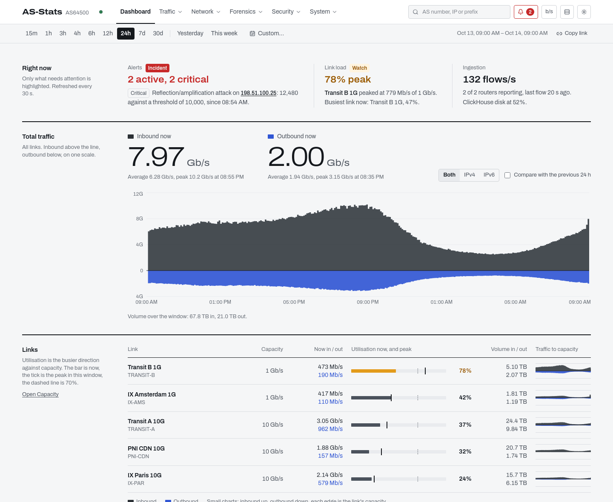
</picture>

<sub>All screenshots use invented data for a fictional network, AS64500 "Example Networks", on documentation address space. [`scripts/demo/`](scripts/demo/) rebuilds it.</sub>

## What you get

**Traffic analytics**
- Top AS, IP, prefix and country over any window, by bytes, packets or flows, IPv4 / IPv6 / both, per link or across all links.
- AS detail (traffic per link, your top IPs with that network and theirs, links to HE.net, PeeringDB and bgp.tools) and IP detail at 1-minute resolution on windows up to 3 hours (2-minute up to 6 hours).
- Private-use ASNs (64512–65534, 4200000000–4294967294) fold into one "Private / Internal" row instead of a dozen anonymous ones.
- Search box and command palette that take an IP, an ASN, an AS name or a prefix; reverse DNS shown next to addresses; CSV export of the tables.

**Capacity**
- Utilisation of each link against its configured capacity, on the busier direction (links are full duplex): now, peak and p95 over the window.
- Days to saturation (80 / 95 / 100 %), from a linear fit on each day's p95 over the last 90 days.
- Load-duration curve per link, and a `link_capacity` alert rule using the same definition.

**Changes**
- Top movers against the previous equal-length window, by AS, prefix, port or country.
- New and disappeared talkers (AS, IP, prefix), p50 / p95 / p99 per link, a compare-with-previous overlay on charts, and a day-of-week × hour heatmap over several weeks.

**Security and DDoS** (`FEATURE_ALERTS`)
- An alert engine that evaluates rules every 30 s against 1-minute pre-aggregated tables, so detection cost does not grow with the raw flow table. 17 default rules: inbound / outbound volume, SYN, UDP and ICMP floods, connection-rate floods, reflection / amplification, port scans from your hosts, carpet bombing of a /24, SMTP abuse, disk usage, link capacity, and a statistical anomaly rule (off by default).
- Rules only fire on your own address space, learned from your `LOCAL_AS` announcements; each alert records the top 5 source IPs at trigger time.
- **Live Threats**: every local host compared with its own usual level at this time of day over the previous 7 days, so a busy server at its normal rate stays quiet. Rows carry the deviation, the attack signature in plain words (SYN flood, NTP / DNS / memcached amplification, port scan, host sweep, SMTP burst…), the closest rule and a 60-minute sparkline. Inbound and outbound views.
- Webhooks to Slack, Microsoft Teams, Discord or any JSON endpoint, with a per-webhook severity filter; an audit log of sensitive actions.
- Optional RFC 7999 blackhole from an alert, through your own BGP daemon (gobgp, BIRD, FRR — see [docs/bgp-blackhole.md](docs/bgp-blackhole.md)).

**Forensics**
- Flow log (`FEATURE_FLOW_SEARCH`): search per-tuple flows by IP or CIDR, AS, port, protocol and time, CSV export up to 100,000 rows, 180-day default retention; a conversations explorer for bidirectional top talkers.
- Top protocols and ports with IANA service names (`FEATURE_PORT_STATS`): each flow counted once, inbound / outbound by the link it crossed, under its service port (the lower of its two ports, so a download from a web server counts under 443, not under the client's ephemeral port).

**Operations**
- Collector for NetFlow v5 / v9, IPFIX and sFlow v5, parsed in Go. Decoding a NetFlow v5 record takes under 0.3 µs on one core (`BenchmarkDecodeV5`, 30-record packets). One production deployment runs on a single node and ingests about 1,300 flows/s, unsampled, from two routers.
- Sampling rate taken from the record, then from the exporter's v9 / IPFIX options data, then from a per-router override.
- OIDC login (PKCE) with admin / viewer roles, read-only API tokens for scripts, scheduled HTML + CSV email reports (`FEATURE_REPORTS`).
- Retention editable at runtime per table, without rewriting existing data; schema migrations embedded in the images and checksum-verified.
- Prometheus metrics for the ingest path, a status page, and multi-arch (amd64 / arm64) images on GHCR.
- Light and dark UI that only uses colour for something abnormal, readable on a phone.

## Screenshots

<table>
  <tr>
    <td width="50%"><a href="docs/screenshots/live-threats-light.png"><picture><source media="(prefers-color-scheme: dark)" srcset="docs/screenshots/live-threats-dark.png">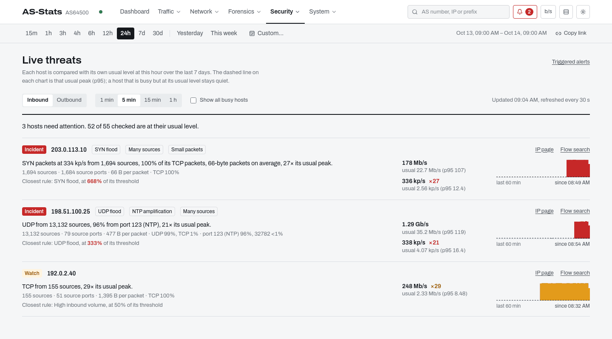</picture></a><br><b>Live Threats</b>: hosts ranked by how far they are from their usual level</td>
    <td width="50%"><a href="docs/screenshots/alerts-light.png"><picture><source media="(prefers-color-scheme: dark)" srcset="docs/screenshots/alerts-dark.png">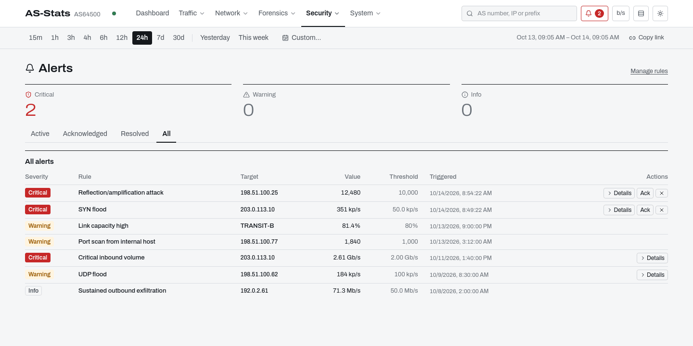</picture></a><br><b>Alerts</b>: lifecycle, acknowledgement, history</td>
  </tr>
  <tr>
    <td><a href="docs/screenshots/top-as-light.png"><picture><source media="(prefers-color-scheme: dark)" srcset="docs/screenshots/top-as-dark.png">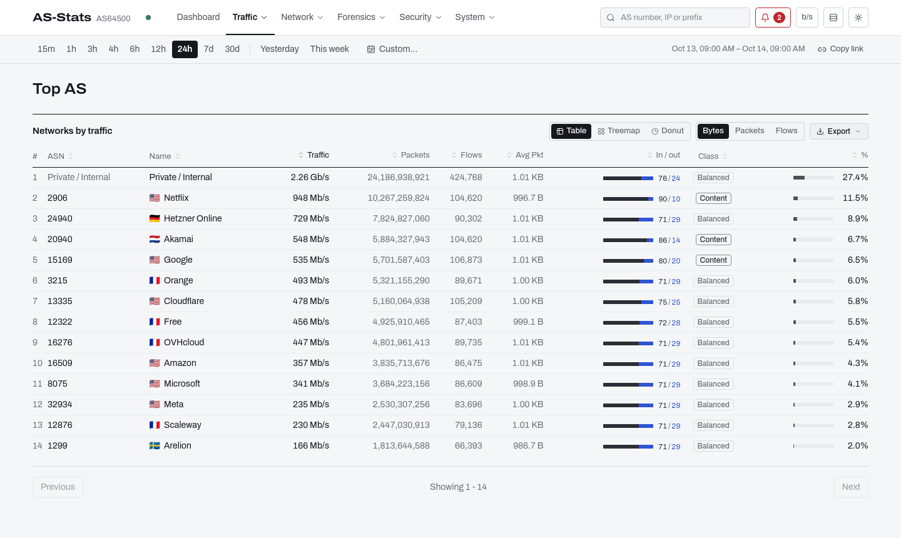</picture></a><br><b>Top AS</b>, with private ASNs grouped</td>
    <td><a href="docs/screenshots/as-detail-light.png"><picture><source media="(prefers-color-scheme: dark)" srcset="docs/screenshots/as-detail-dark.png">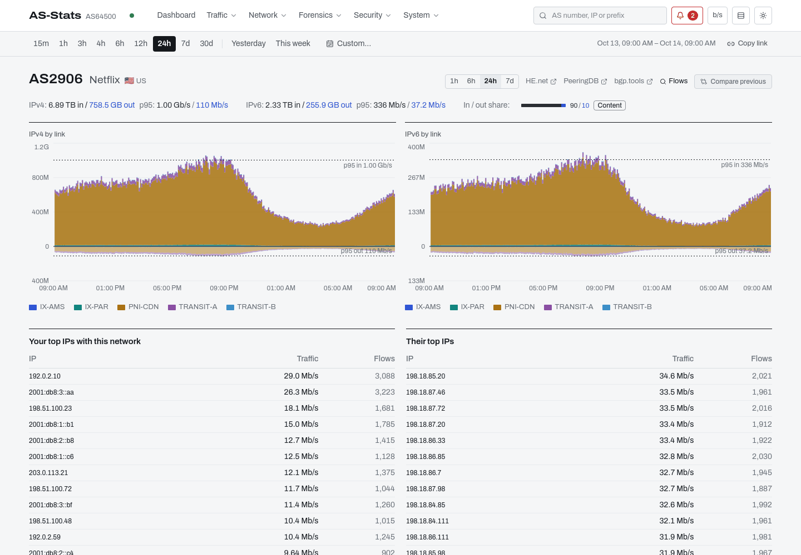</picture></a><br><b>AS detail</b>: traffic per link and top IPs on both sides</td>
  </tr>
  <tr>
    <td><a href="docs/screenshots/link-detail-light.png"><picture><source media="(prefers-color-scheme: dark)" srcset="docs/screenshots/link-detail-dark.png">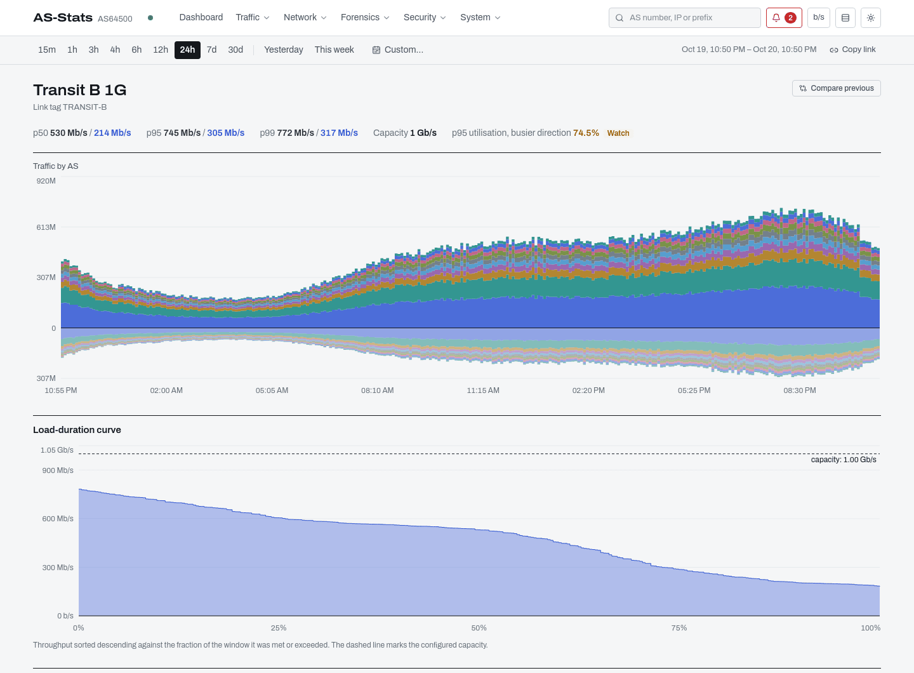</picture></a><br><b>Link detail</b>: traffic by AS and load-duration curve</td>
    <td><a href="docs/screenshots/capacity-light.png"><picture><source media="(prefers-color-scheme: dark)" srcset="docs/screenshots/capacity-dark.png">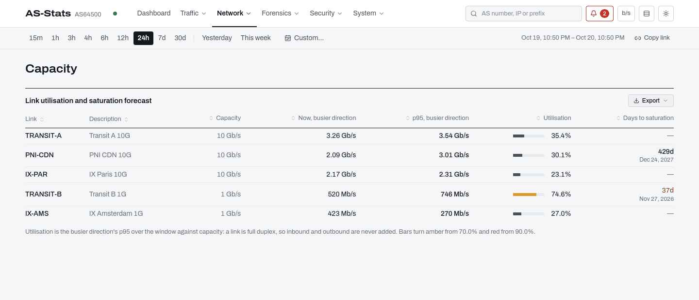</picture></a><br><b>Capacity</b>: p95 utilisation and days to saturation</td>
  </tr>
  <tr>
    <td><a href="docs/screenshots/changes-light.png"><picture><source media="(prefers-color-scheme: dark)" srcset="docs/screenshots/changes-dark.png">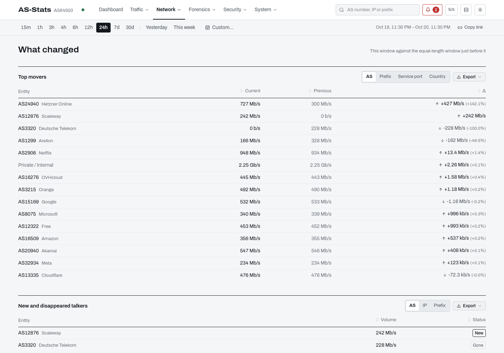</picture></a><br><b>Changes</b>: movers, new and disappeared talkers</td>
    <td><a href="docs/screenshots/heatmap-light.png"><picture><source media="(prefers-color-scheme: dark)" srcset="docs/screenshots/heatmap-dark.png">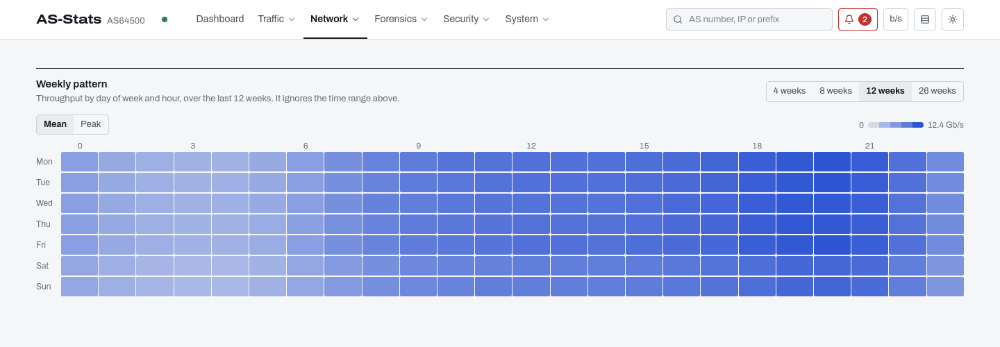</picture></a><br><b>Weekly pattern</b>: day of week × hour</td>
  </tr>
  <tr>
    <td><a href="docs/screenshots/flow-search-light.png"><picture><source media="(prefers-color-scheme: dark)" srcset="docs/screenshots/flow-search-dark.png">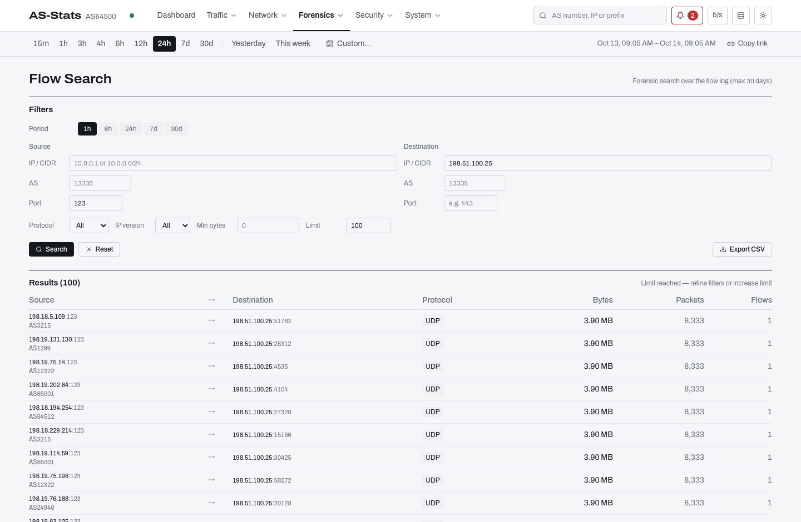</picture></a><br><b>Flow Search</b>: the reflectors behind an amplification</td>
  </tr>
</table>

<details>
<summary>On a phone</summary>
<p>
  <picture><source media="(prefers-color-scheme: dark)" srcset="docs/screenshots/home-mobile-dark.png">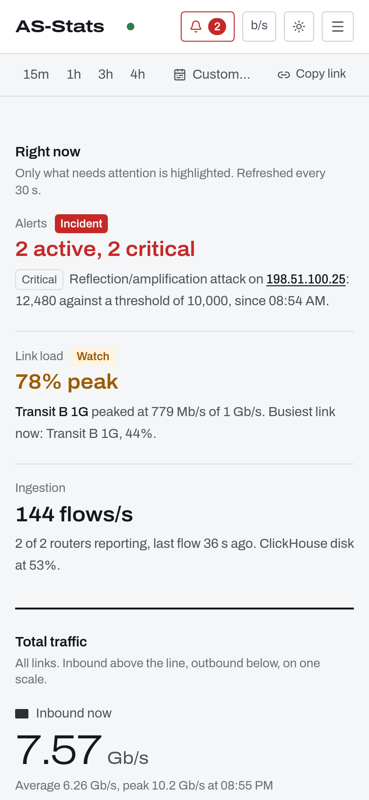</picture>
</p>
</details>

## Quick start

You need a Linux host with Docker 24+ and Compose v2, UDP 2055 (NetFlow /
IPFIX) and 6343 (sFlow) reachable from your routers, and a reverse proxy for
TLS.

```bash
git clone https://github.com/nextmap-io/as-stats.git
cd as-stats
cp .env.example .env
$EDITOR .env      # CLICKHOUSE_PASSWORD, LOCAL_AS, API_CORS_ORIGINS, OIDC_*
docker compose -f docker-compose.ghcr.yml up -d
```

The UI listens on `127.0.0.1:8081`. Then:

1. put your [reverse proxy](#reverse-proxy) in front of it;
2. [point your routers](#point-a-router-at-the-collector) at the collector;
3. [map router interfaces to links](#map-your-interfaces) and set their capacity;
4. turn on the [optional features](#optional-features) you want.

For a trusted local evaluation without an identity provider, set
`AUTH_ENABLED=false` **and** `ALLOW_UNAUTHENTICATED=true`. To look around
without routers, [`scripts/demo/`](scripts/demo/) starts a throwaway stack
with invented data.

## Architecture

```
┌──────────┐                                          ┌────────────┐
│ Routers  │ ── UDP 2055 / 6343 ─────────►            │ Collector  │
└──────────┘   NetFlow / IPFIX / sFlow                │   (Go)     │
                                                      └─────┬──────┘
                                                            │ batched
                                                            │ INSERT
                                                            ▼
                                                      ┌────────────┐
                              ┌────────── reads ────► │ ClickHouse │
                              │                       └─────┬──────┘
                              │                             │
                              │  optional: alert engine     │
                              │  reads hot 1-min tables ◄───┘
                              │
                        ┌─────┴────┐
                        │ API (Go) │ ◄─── REST JSON
                        └─────┬────┘
                              │
                        ┌─────┴────┐
                        │ Frontend │ ◄─── HTTPS via your reverse proxy
                        │  (React) │
                        └──────────┘
```

The collector is a single Go binary with a channel pipeline (UDP listener →
decoder workers → enricher → batch writer). Materialised views roll each
INSERT up into 5-minute, hourly and daily tables per AS, IP, prefix, link and
port. The API server is another Go binary on `chi` with a 30-second in-memory
response cache. The frontend is a React SPA served by nginx. The alert engine
runs inside the collector.

## Deployment in detail

### Prerequisites

- Linux host with Docker 24+ and Compose v2
- UDP/2055 (NetFlow / IPFIX) and UDP/6343 (sFlow) reachable from your routers
- A reverse proxy that terminates TLS (Caddy, nginx, Traefik)

### Deploy

```bash
git clone https://github.com/nextmap-io/as-stats.git
cd as-stats

cp .env.example .env
$EDITOR .env   # set CLICKHOUSE_PASSWORD, LOCAL_AS, API_CORS_ORIGINS and OIDC
# For a trusted local evaluation without OIDC, explicitly set:
# AUTH_ENABLED=false and ALLOW_UNAUTHENTICATED=true

docker compose -f docker-compose.ghcr.yml up -d
```

The one-shot migration job must complete before the collector and API are
allowed to start. Four long-running services then remain: ClickHouse, the
collector, API, and frontend. The frontend listens on `127.0.0.1:8081` by
default — put your reverse proxy in front of it.

### Schema migrations and upgrades

Every image contains the exact SQL migrations built with that release. The
`migrate` service serializes schema changes with an exclusive ClickHouse DDL
lock, records each version and SHA-256 checksum in `schema_migrations`, and
blocks API/collector startup if a migration fails or a released migration was
modified.

On the first upgrade from an older AS-Stats installation, a volume without
migration history is inspected. Only a complete, contiguous schema recognized
by all version probes is baselined; old migrations are **not replayed**. An
ambiguous or partially applied schema stops the deployment for operator review.
Set `MIGRATE_AUTO_BASELINE=false` to require manual review for every legacy
volume.

ClickHouse cannot make a multi-statement DDL migration transactional. A failed
migration is therefore marked dirty and never retried automatically. Inspect
the partial DDL and take a backup before repairing it. A stale lock is also left
in place after an unclean migrator crash; after verifying no migrator is
running, inspect and remove it explicitly:

```sql
SELECT * FROM asstats.schema_migration_lock;
DROP TABLE asstats.schema_migration_lock;
```

**Upgrading to 3.4 (flow log sort key, migration 000017): no manual step.**
`flows_log` gets a new sort order that makes Flow Search IP lookups an order
of magnitude faster (see [Flow Search performance](#flow-search-performance)).
Nothing is copied: the migration renames the existing table to
`flows_log_legacy` and swaps in an empty `flows_log` in one atomic
`EXCHANGE TABLES`, which takes milliseconds whatever the size of the table;
the collector keeps inserting throughout and no flow is lost or counted twice.
Flow Search, its time series and Conversations read both tables, so history
stays searchable. `flows_log_legacy` follows the `flows_log` retention (and
cold tier) and **empties itself** as its partitions age out — within the
`flows_log` retention, 180 days by default; Admin › Storage lists it as
*legacy (pre-3.4 layout), expires by itself*. If `flows_log` had been
switched to a hot/cold storage policy, the new table is switched to it by the
reconciler on its first cycle (see step 3 of
[Cold storage on a second disk](#cold-storage-on-a-second-disk)).

**Upgrading to 3.5 (port statistics, migration 000018): no manual step, but
port history restarts.** Until 3.4, `traffic_by_port` stored every flow twice
— once as "in" under its destination port, once as "out" under its source
port — so Top Protocols showed inbound = outbound and every total was doubled.
From 3.5 each flow is stored once, under the direction of the link it crossed
and its service port. The old rows cannot be split back into flows, so they are
**not converted**: the migration keeps the table as `traffic_by_port_legacy`
(atomic `EXCHANGE TABLES`, milliseconds, the collector keeps inserting) and
starts an empty `traffic_by_port`. Top Protocols, Top Ports and Changes › port
movers read only the new table and say so while the selected window reaches
back before the upgrade. `traffic_by_port_legacy` is never shown; it follows
the `traffic_by_port` retention and cold tier and **empties itself** (365 days
by default); Admin › Storage lists it as *legacy (pre-3.5 port stats), expires
by itself*. As in 3.4, a hot/cold storage policy is re-applied to the new table
by the reconciler. Flows on no configured link are stored with no direction and
are not listed under Inbound / Outbound (as in the link totals).

### Upgrading ClickHouse (24.3 → 26.8 LTS)

The compose files still default to ClickHouse 24.3 LTS, which is out of
upstream support. AS-Stats is tested on both 24.3 and 26.8 LTS, and CI runs
the integration suite on both. The server image is chosen with
`CLICKHOUSE_IMAGE` in `.env`. Read
[docs/upgrades/clickhouse-26.8.md](docs/upgrades/clickhouse-26.8.md) before
switching. In short:

- **The CPU must have AVX2.** ClickHouse 26.6+ binaries need x86-64-v3; check
  with `grep -c avx2 /proc/cpuinfo`. On Proxmox, the default VM CPU type
  `x86-64-v2-AES` does not expose it.
- **The upgrade is one-way.** Once 26.8 has written to the volume, 24.3 no
  longer starts on it. Take a VM / disk snapshot first. Mounting
  `clickhouse/config.d/merge-tree-downgrade-compat.xml.example` during a soak
  period keeps the data readable by 24.3.
- **Stop the collector before restarting ClickHouse** and start it again after
  `migrate`. The ingestion gap then equals the restart window, about a minute.
- `migrate` has nothing to apply, and the retention reconciler, flow log, cold
  tier and every API response behave the same on 26.8 (rehearsed on a
  production-shaped hot/cold volume).

### Reverse proxy

Caddyfile example:

```caddy
as-stats.example.com {
    reverse_proxy 127.0.0.1:8081
    encode gzip
}
```

### Point a router at the collector

**Junos (NetFlow v9, inline-jflow)**:

```
set forwarding-options sampling instance AS-STATS input rate 1000
set forwarding-options sampling instance AS-STATS family inet output flow-server <COLLECTOR_IP> port 2055
set forwarding-options sampling instance AS-STATS family inet output flow-server <COLLECTOR_IP> autonomous-system-type origin
set forwarding-options sampling instance AS-STATS family inet output inline-jflow source-address <LOOPBACK>
```

**Cisco IOS-XE (Flexible NetFlow v9)**:

```
flow record AS-STATS-RECORD
 match ipv4 source address
 match ipv4 destination address
 match interface input
 match interface output
 match flow direction
 collect counter bytes long
 collect counter packets long
 collect routing source as 4-octet
 collect routing destination as 4-octet

flow exporter AS-STATS-EXPORT
 destination <COLLECTOR_IP>
 transport udp 2055
 source Loopback0

flow monitor AS-STATS-MONITOR
 exporter AS-STATS-EXPORT
 record AS-STATS-RECORD

interface <UPLINK>
 ip flow monitor AS-STATS-MONITOR input
 ip flow monitor AS-STATS-MONITOR output
```

**MikroTik RouterOS 7 (Traffic Flow / IPFIX)**:

```
/ip traffic-flow set enabled=yes interfaces=<UPLINK>
/ip traffic-flow target add dst-address=<COLLECTOR_IP> port=2055 version=ipfix
```

**Sampling.** Every flow is scaled by its 1-in-N sampling rate, taken in
this order: a rate carried in the record itself (sFlow, NetFlow v5 header,
v9/IPFIX `SAMPLING_INTERVAL`), the rate the exporter announces in its v9 /
IPFIX options data (`SAMPLING_INTERVAL`, `FLOW_SAMPLER_RANDOM_INTERVAL`,
`samplingPacketInterval`/`Space`, … — matched per sampler ID when records
carry `FLOW_SAMPLER_ID` / `selectorId`), then `COLLECTOR_SAMPLING_OVERRIDE`,
and finally 1 (unsampled). Records seen before the first options packet are
counted as unsampled, so expect a few minutes of under-counting after a
collector restart on a sampled router. The rate in use per router is exported
as `asstats_sampling_rate{router}`.

With `ip flow monitor … input` **and** `output` on the same uplinks (as in the
IOS-XE example), keep `match flow direction`: a packet crossing two monitored
uplinks is exported twice, and the direction field is what lets the collector
credit one copy as inbound on the first link and the other as outbound on the
second, instead of counting it twice as inbound.

### Map your interfaces

Open the UI → **Links** → **Add link** to bind a router IP + SNMP ifindex
to a human-friendly tag, and set the link's capacity so utilisation and
saturation forecasts work. The collector reloads link config every 60
seconds, no restart needed.

You can find the SNMP ifindex with `show snmp mib ifmib ifindex <interface>`
on Cisco, `show snmp mib walk` on Junos, or `/interface print detail` on
MikroTik.

## Configuration

Everything is environment-variable driven. The full list lives in
[`.env.example`](.env.example); the highlights are:

### Core

| Variable | Default | Description |
|---|---|---|
| `CLICKHOUSE_PASSWORD` | *required* | Strong password for the `asstats` user |
| `CLICKHOUSE_IMAGE` | `clickhouse/clickhouse-server:24.3-alpine` | ClickHouse server image used by the compose files. 26.8 LTS (`…:26.8.33.10-alpine`) is tested too; switching is a one-way data upgrade, see [Upgrading ClickHouse](#upgrading-clickhouse-243--268-lts) |
| `COLLECTOR_LISTEN_NETFLOW` | `:2055` | NetFlow / IPFIX UDP listen address |
| `COLLECTOR_LISTEN_SFLOW` | `:6343` | sFlow UDP listen address |
| `COLLECTOR_BATCH_SIZE` | `50000` | Burst ceiling per batch INSERT (flush on size or timer, whichever fires first) |
| `COLLECTOR_FLUSH_INTERVAL` | `15s` | Flush cadence. Each INSERT creates ~21 parts across the materialised views, so fewer, larger INSERTs mean far less merge work |
| `COLLECTOR_WORKERS` | `4` | Decoder goroutines (raise on multi-Gbps) |
| `COLLECTOR_SAMPLING_OVERRIDE` | *(none)* | Last-resort per-router sampling rate, e.g. `2001:db8::1=1000,192.0.2.1=512`; only used when neither the record nor the exporter's options data gives one |
| `COLLECTOR_FLUSH_TIMEOUT` | `30s` | Upper bound on one batch INSERT; a failed batch is dropped and counted (`asstats_flows_dropped_total`), not retried |
| `COLLECTOR_SHUTDOWN_TIMEOUT` | `40s` | Bound on the SIGTERM drain + final flush; keep below the container stop grace period |
| `LOCAL_AS` | *(none)* | Your AS number. At startup the collector and the API fetch its announced prefixes from RIPEstat: they define "your" addresses (alert scope, Live Threats, internal / external IP views), and the collector remaps private ASNs on flows from those prefixes to this AS |
| `API_CORS_ORIGINS` | `http://localhost:5173` | Comma-separated allowed origins |
| `RETENTION_RECONCILE_INTERVAL` | `15m` | How often the collector applies retention changes |
| `CONFIG_PURGE_DAYS` | `30` | Soft-deleted rules, webhooks, host groups and report schedules are purged after this many days |

### Authentication

| Variable | Default | Description |
|---|---|---|
| `AUTH_ENABLED` | `true` | Master switch for OIDC; invalid values stop startup |
| `ALLOW_UNAUTHENTICATED` | `false` | Explicit opt-out required with `AUTH_ENABLED=false`; use only on trusted local/test networks |
| `OIDC_ISSUER_URL` | | e.g. `https://login.microsoftonline.com/<tenant>/v2.0` |
| `OIDC_CLIENT_ID` | | App ID from your IdP |
| `OIDC_CLIENT_SECRET` | | Client secret |
| `OIDC_REDIRECT_URL` | | `https://your-domain/auth/callback` |
| `OIDC_SCOPES` | `openid profile email` | Scopes requested from the IdP |

The OIDC callback grants the **admin** role to any user whose `roles` (or
`groups`) claim contains `Admin.All`. Anything else maps to **viewer**. A
role is captured when the session is created: after changing someone's role,
they must log out and back in.

The API fails closed by default. Running without OIDC requires both
`AUTH_ENABLED=false` and `ALLOW_UNAUTHENTICATED=true`.

Admins can create **read-only API tokens** (Admin › Tokens) for scripts
and dashboards: send them as `Authorization: Bearer <token>`; they are
limited to safe (GET) methods.

### Optional features

Four independent flags, all off by default. Each one only uses its own
tables (the migrations create them either way).

| Variable | Default | What it enables |
|---|---|---|
| `FEATURE_FLOW_SEARCH` | `false` | Forensic flow log + Flow Search UI + CSV export + Conversations |
| `FLOW_LOG_RETENTION_DAYS` | `180` | **Seeds** the `flows_log` retention policy on first startup only. Afterwards `retention_policies` is authoritative — change it via Admin › Storage (`PUT /admin/retention/flows_log`) |
| `FEATURE_PORT_STATS` | `false` | Top Protocols + Top Ports views |
| `FEATURE_ALERTS` | `false` | Alert engine + Alerts + Live Threats + webhooks + audit log + rule admin |
| `ALERT_EVAL_INTERVAL` | `30s` | How often the alert engine evaluates rules |
| `ALERT_STALE_THRESHOLD` | `5m` | Active alerts auto-resolve after this gap of silence |
| `ALERT_REARM_WINDOW` | `1h` | If a rule fires again on the same target within this long after its alert was last seen, that alert is re-opened (no new notification) instead of a new one being created. A rule's `cooldown_seconds` raises it for that rule; `0` leaves only the cooldowns |
| `FEATURE_REPORTS` | `false` | Scheduled HTML + CSV email reports (Admin › Reports) |
| `SMTP_HOST`, `SMTP_FROM` | | Required with `FEATURE_REPORTS` |
| `SMTP_PORT` / `SMTP_USER` / `SMTP_PASS` / `SMTP_STARTTLS` | `587` / – / – / `true` | Mail submission settings |

> **Note**: schema migrations are always applied by the one-shot `migrate`
> service before the API and collector start. Feature flags only control
> runtime behaviour; never run individual SQL files by hand during deployment.

### Metrics

| Variable | Default | Description |
|---|---|---|
| `COLLECTOR_PROMETHEUS_ADDR` | `:9090` | Collector `/metrics` and `/healthz` listener; empty disables it |
| `PROMETHEUS_ALLOW_CIDR` | *(open)* | Comma-separated IPs / CIDRs allowed to scrape `/metrics` (both binaries) |
| `PROMETHEUS_USER` / `PROMETHEUS_PASS` | | Optional basic auth for `/metrics`; both must be set |

BGP blackholing has its own variables (`BGP_ENABLED`, `BGP_PEER_ADDRESS`,
`BGP_PEER_AS`, `BGP_LOCAL_AS`, `BGP_NEXT_HOP` / `BGP_NEXT_HOP_V6`,
`BGP_COMMUNITY`, `BGP_*_CMD`, the safety rails `BGP_ALLOWED_PREFIXES`,
`BGP_PROTECTED_PREFIXES`, `BGP_MAX_ACTIVE_BLOCKS`,
`BGP_AUTO_BLOCK_MAX_PER_HOUR`, `BGP_DRY_RUN`…, and `BGP_API_URL` +
`BGP_API_TOKEN` shared with the collector) — see
[docs/bgp-blackhole.md](docs/bgp-blackhole.md).

## Alert engine

When `FEATURE_ALERTS=true`, the collector spawns a goroutine that evaluates
configurable rules every 30 seconds against pre-aggregated 1-minute hot
tables, over complete minutes only. Detection reads `flows_raw` only to
confirm a few candidates (port scans, SMTP abuse) and to enrich new alerts,
so its cost hardly grows with the raw flow volume.

### Rule types

| Type | What it detects |
|---|---|
| `volume_in` | bps / pps received by a single destination |
| `volume_out` | bps / pps sent from a single source (compromised host) |
| `syn_flood` | TCP SYN-only packet rate to a destination — TCP state-table abuse |
| `amplification` | Many unique source IPs hitting one destination, with optional sustained-bps floor to filter scanners |
| `port_scan` | An internal source sending connection probes to many distinct destination ports: TCP SYN without ACK, or UDP / flagless TCP from a port ≥ 1024 to a port < 1024. Replies of a busy server to its clients' ephemeral ports do not count |
| `icmp_flood` | ICMP packet rate to a destination — almost never legitimate at high rates |
| `udp_flood` | UDP packet rate to a destination — DNS / NTP query flood signature |
| `connection_flood` | High distinct flow count per destination — Slowloris / half-open scan |
| `subnet_flood` | Aggregate traffic to one IPv4 subnet (e.g. a /24) of your prefixes — carpet bombing spread under the per-host thresholds |
| `smtp_abuse` | An internal host sending to SMTP ports at a sustained rate (compromised relay) |
| `disk_usage` | A ClickHouse data disk above a percentage |
| `link_capacity` | A link's p95 utilisation (busier direction) above a percentage of its capacity |
| `anomaly` | A link's hourly throughput far above the median of the same hour of the week (median + k·MAD) |

The 17 rules seeded on first startup (only when `alert_rules` is empty) cover
all of these; the anomaly example is disabled until tuned. Edit them in
Admin › Alert Rules.

### Fewer false positives: usual level and re-arm

- **Relative to the host's usual level** (`volume_in` / `volume_out`): a rule
  with a *baseline factor* N fires only when the host is above the threshold
  **and** at least N times its usual level — its per-minute 99th percentile at
  the same time of day over the last 7 days. A busy server at its normal level
  stays quiet; a host without that history is judged on the threshold alone,
  so a flood on a new host still fires. The seeded "High inbound / outbound
  volume" rules use 2×, "Sustained outbound exfiltration" 3×; the 2 Gb/s
  critical rule stays absolute. Existing installs: the collector applies these
  factors at startup only to the seeded rules you never edited.
- **Re-arm instead of re-fire**: when a rule fires again on the same target
  within the re-arm window (`max(cooldown, ALERT_REARM_WINDOW)`, 1 h by
  default) after its alert resolved, that alert is re-opened ("re-opened ×N" on
  the Alerts page), without a new notification — unless the value is at least
  twice the alert's peak, which is a new incident. An acknowledged alert that
  is still firing is kept up to date instead of being duplicated.

Every rule is bound to a **target filter** — by default the local AS
prefixes loaded from RIPEstat — so alerts only fire on IPs you actually
operate. Each triggered alert is enriched with the **top 5 source IPs**
hammering the target, pulled from `flows_raw` at trigger time so the
on-call engineer doesn't need to dig further.

### Live Threats

The Alerts page shows what already fired. **Live Threats** (`/live`) shows
what is building, ranked by **how abnormal** each of your hosts is rather
than by raw volume:

- every local host seen in the window is compared with **its own usual
  traffic** — the same time of day over the previous 7 days (per-minute p50 /
  p95 of bps and pps). A busy server at its everyday level stays quiet;
- rows are matched against **attack signatures** — SYN / UDP / ICMP flood,
  reflection-amplification (with the reflector port, e.g. NTP/123), small
  packets, many sources; outbound: port scan, host sweep, SMTP burst,
  outbound flood — and against the active alert rules (closest rule, % of its
  threshold);
- each host gets a level: **incident**, **watch** or **normal**. Only the
  first two are listed by default; "Show all busy hosts" (`all=1`) lists the
  others too.

**Inbound** looks at your destinations (DDoS targets), **outbound** at your
sources (compromised hosts). Each row explains itself in one sentence and
carries a 60-minute sparkline against the usual peak, the time it went above
its usual level, and links to the IP page and a pre-filtered Flow Search.
Window 1 min / 5 min / 15 min / 1 h, refreshed every 30 s. API:
`GET /api/v1/threats/live?direction=in|out&window=300&all=0`.

### BGP blackhole hook

With `BGP_ENABLED=true` the API announces RFC 7999 blackholes (`65535:666`
plus NO_EXPORT) through your own BGP daemon — gobgp by default, BIRD / FRR /
ExaBGP through command templates run without a shell — from the BGP page,
the Block button on an alert or Live Threats, or automatically from rules
with action `auto_block` (the collector asks the API with `BGP_API_TOKEN`).
Every block passes the same safety rails: only addresses inside the
allow-list (`BGP_ALLOWED_PREFIXES`, else your LOCAL_AS prefixes; none = every
block refused), never the BGP peer / next hops / `BGP_PROTECTED_PREFIXES`,
host routes by default, at most 50 active and 10 automatic per hour, every
block expires (1 h default, 24 h max). Blocks survive restarts (expired ones
are withdrawn, the others re-announced) and are reconciled with the daemon's
RIB every minute. `BGP_DRY_RUN=true` rehearses without announcing anything.
`/alerts/{id}/block` answers **409** when BGP is off and **422** for alerts
without a single host target or a target the rules refuse. Setup, daemon and
router examples, metrics: [docs/bgp-blackhole.md](docs/bgp-blackhole.md).

## Hardware sizing

Rough starting points, not benchmarks:

| Traffic level | Flows / sec | CPU | RAM | Disk (1 year, base install) |
|---|---|---|---|---|
| Small (< 1 Gbps) | < 5k | 2 vCPU | 4 GB | 50 GB |
| Medium (1–10 Gbps) | 5k–50k | 4 vCPU | 8 GB | 200 GB |
| Large (10–100 Gbps) | 50k–500k | 8 vCPU | 16 GB | 1 TB |
| Very large (100+ Gbps) | 500k+ | 16 vCPU | 32 GB | 2+ TB |

ClickHouse will happily eat most of the available RAM — set
`deploy.resources.limits.memory` in your compose override to cap it. SSDs
are strongly recommended for query performance even at small sizes.

`FEATURE_FLOW_SEARCH` adds significant storage: budget roughly **+250 GB
per 6 months per Gbps** at 1:1000 sampling. Port stats and reports are
lightweight; the alert hot tables are bounded by their 7-day retention.

### Flow Search performance

`flows_log` (since 3.4) is sorted by 15-minute time bucket, then destination
IP, then the rest of the tuple. A search by destination IP therefore reads
only that host's rows in each bucket, and a search by source IP is narrowed by
a bloom filter. Measured on one production day (99 M rows, 620 k distinct
destination IPs, cold caches, top 100 by bytes):

| Search | 3.3 layout | 3.4 layout |
|---|---|---|
| busy destination IP, 24 h | 2.3 s, 5.2 GiB read | 0.32 s, 73 MiB |
| busy destination IP, 1 h | — | 0.11 s, 3.5 MiB |
| busy source IP, 24 h | 2.6 s, 6.2 GiB | 1.1 s, 1.5 GiB |
| 15-minute window, no IP | 0.16 s | 0.16 s |

Searches by destination IP are the fastest; prefer them (with a narrow time
range) when you have the choice. Data written before the upgrade keeps the
old layout until it ages out (see the 3.4 upgrade note above).

### Default retention

| Table | Granularity | Retention |
|---|---|---|
| `flows_raw` | per flow | 3 days |
| `traffic_by_as` / `traffic_by_link` | 5 min | 90 days |
| `*_hourly` rollups | 1 hour | 2 years |
| `*_daily` rollups | 1 day | 5 years |
| `traffic_by_ip` | 5 min | 14 days |
| `traffic_by_prefix` | 5 min | 30 days |
| `flows_log` *(opt)* | per tuple | 180 days *(configurable)* |
| `flows_log_legacy` *(after the 3.4 upgrade)* | per tuple | follows `flows_log` |
| `traffic_by_port` *(opt)* | 5 min | 365 days |
| `traffic_by_port_legacy` *(after the 3.5 upgrade, never read)* | 5 min | follows `traffic_by_port` |
| `traffic_by_dst_1min` / `traffic_by_src_1min` *(opt)* | 1 min | 7 days |

All TTLs are enforced by ClickHouse itself — no cron jobs to maintain.

Retention is **editable at runtime**: every table above has a row in
`retention_policies`, surfaced in Admin › Storage and via
`PUT /admin/retention/{table}`. A reconciler in the collector applies any change
to the live table. The `ALTER` is metadata-only — it never rewrites existing
parts, which matters because a whole-table rewrite lands on the very disk you
are usually trying to free. Because already-merged parts keep the expiry they
were written with, the reconciler also drops any partition whose newest row is
entirely past the retention (`DROP PARTITION`, no rewrite), so lowering a
retention frees the old data on the next cycle instead of months later.
The same page shows table sizes, disk usage and TTL lag.

ClickHouse's own `system.*_log` tables share this volume and are unbounded by
default (they reached ~12 GiB on one deployment and helped fill the disk). The
Compose files mount `clickhouse/config.d/system-logs-ttl.xml`, which caps them
at 7 days. Mount that **file**, not the `config.d` directory — a directory
bind-mount masks the image's own `docker_related_config.xml` and ClickHouse then
listens on loopback only, unreachable from the other containers while its
healthcheck still passes.

### Cold storage on a second disk

The big tables — `flows_log`, and to a lesser extent `traffic_by_port` — can
keep their recent data on the fast disk and move older data to a second,
larger and slower one (an HDD), which buys a much longer `flows_log`
retention for the same SSD. ClickHouse does the storage side through a
*storage policy*; AS-Stats decides per table when data moves.

**1. Declare the disk and the policy.** Copy
[`clickhouse/config.d/storage-hot-cold.xml.example`](clickhouse/config.d/storage-hot-cold.xml.example)
to `clickhouse/config.d/storage-hot-cold.xml` (it is not loaded by default):

```xml
<clickhouse>
    <storage_configuration>
        <disks>
            <cold>
                <path>/var/lib/clickhouse-cold/</path>
            </cold>
        </disks>
        <policies>
            <hot_cold>
                <volumes>
                    <default>                 <!-- the hot volume: existing disk -->
                        <disk>default</disk>
                    </default>
                    <cold>
                        <disk>cold</disk>
                        <prefer_not_to_merge>true</prefer_not_to_merge>
                    </cold>
                </volumes>
                <move_factor>0</move_factor>
            </hot_cold>
        </policies>
    </storage_configuration>
</clickhouse>
```

The hot volume **must be named `default`**: ClickHouse only lets a table switch
to a policy that still contains every volume of its current one, and an
existing table's policy is `default` with a volume `default` — a volume named
`hot` is refused with *New storage policy shall contain volumes of the old
storage policy*. The second volume must be named **`cold`**: that is the name
AS-Stats looks for. `prefer_not_to_merge` stops ClickHouse from re-merging
(re-writing) parts on the slow disk. `move_factor` is 0 so data moves only by
age; ClickHouse's default (0.1) moves parts by size once the hot volume is
under 10 % free, which can put the newest data on the slow disk — watch the
hot disk with the `disk_usage` rule instead.

**2. Mount the disk and the file** in a Compose override (bind-mount the
*file*, never the `config.d` directory — see above). The directory must belong
to the `clickhouse` user of the image (uid/gid 101):

```yaml
# docker-compose.override.yml
services:
  clickhouse:
    volumes:
      - /mnt/hdd/clickhouse-cold:/var/lib/clickhouse-cold
      - ./clickhouse/config.d/storage-hot-cold.xml:/etc/clickhouse-server/config.d/storage-hot-cold.xml:ro
```

```bash
sudo mkdir -p /mnt/hdd/clickhouse-cold && sudo chown 101:101 /mnt/hdd/clickhouse-cold
docker compose up -d clickhouse
docker compose exec clickhouse clickhouse-client -q \
  "SELECT policy_name, volume_name, disks FROM system.storage_policies"
```

**3. Switch the tables to the policy, once** (metadata-only, nothing is
rewritten or moved by this statement):

```sql
ALTER TABLE asstats.flows_log       MODIFY SETTING storage_policy = 'hot_cold';
ALTER TABLE asstats.traffic_by_port MODIFY SETTING storage_policy = 'hot_cold';
```

You can also skip this step: when a table has a "Move to cold after" value
but is still on ClickHouse's `default` policy, and **exactly one** configured
policy has a first volume `default` (disk `default`) followed by a volume
`cold`, the reconciler runs this `ALTER` itself and logs it. With no such
policy, or several, it leaves the table alone and logs why once. This is how
the `flows_log` created by the 3.4 upgrade and the `traffic_by_port` created by
the 3.5 upgrade inherit `hot_cold`.

**4. Set "Move to cold after (days)"** next to the retention in Admin ›
Storage (or `PUT /admin/retention/{table}` with `{"ttl_days": 240,
"enabled": true, "cold_after_days": 30}`). It must be lower than the
retention; 0 turns the cold tier off. The field is disabled, with a note, for
tables whose storage policy has no `cold` volume. On its next cycle the
reconciler:

- rewrites the table TTL as
  `ts + INTERVAL 30 DAY TO VOLUME 'cold', ts + INTERVAL 240 DAY` (still
  metadata-only), so new data moves on its own when it gets old;
- moves the partitions written *before* that change — they carry no move rule
  and would otherwise stay on the fast disk forever — with
  `ALTER TABLE … MOVE PARTITION … TO VOLUME 'cold'`, oldest first and **at most
  3 partitions per table per cycle** so that switching the tier on for months
  of history does not write it all to the HDD in one burst. Each move is
  logged with its size; a failure (e.g. the cold disk is full) is logged and
  retried next cycle.

Partitions past the retention are still dropped wherever they live. Admin ›
Storage shows every disk (path, used, free) and each table's hot / cold split;
the `disk_usage` alert rule and the header's disk indicator watch every disk
and report the fullest, so a filling HDD is caught too. Sizing example for
`flows_log` at ~1 GiB/day: 30 days hot (~32 GiB) and a 240-day retention keeps
~210 days (~220 GiB) on a 300 GB HDD.

## Monitoring

Both binaries expose Prometheus metrics on `/metrics` (guarded by
`PROMETHEUS_ALLOW_CIDR` and/or basic auth — see [Metrics](#metrics)). The
collector also serves `/healthz` on the same listener; use it rather than
probing the UDP ports.

The ingest counters worth alerting on:

| Metric | Meaning |
|---|---|
| `asstats_flows_received_total{protocol}` | Flows decoded from routers (`netflow5`, `netflow9`, `ipfix`, `sflow`) |
| `asstats_flowsets_dropped_no_template_total{router}` | v9/IPFIX data sets dropped because the exporter's template is not known yet (normal for one template refresh after a restart) |
| `asstats_sampling_rate{router}` | Sampling rate applied to each exporter's latest flows |
| `asstats_udp_socket_drops{listener}` | Datagrams the kernel dropped before the collector read them (Linux; use `increase()`) |
| `asstats_udp_receive_buffer_bytes{listener}` | Receive buffer actually granted — capped by `net.core.rmem_max` |
| `asstats_pipeline_queue_length{queue}` / `_capacity` | Fill level of the internal channels; a queue stuck at capacity is the bottleneck |
| `asstats_flows_both_interfaces_linked_total` | Flows whose input and output interfaces are both configured links |
| `asstats_flows_written_total` | Flows committed to ClickHouse |
| `asstats_batch_write_errors_total` | Batch INSERTs that failed |
| `asstats_flows_dropped_total` | Flows discarded because their batch failed |
| `asstats_decode_errors_total{protocol}` | Malformed / undecodable packets |
| `asstats_timestamps_clamped_total` | Flows whose exporter timestamp was out of range and rewritten to receive time |

`rate(asstats_batch_write_errors_total[5m]) > 0` is the alert that matters: a
database refusing writes (full disk, bad credentials, schema drift) otherwise
looks exactly like "no traffic", because the success counters simply stop
advancing. A steadily rising `asstats_timestamps_clamped_total` means a router
has a broken clock — left unclamped those flows land in partitions that never
expire.

## Networking notes

The collector runs in **`network_mode: host`** so it sees the real source
IP of routers. Without that, Docker NAT replaces every router IP with the
bridge gateway and link enrichment breaks.

Some Cisco IOS-XE images send NetFlow with **source port 0**, which Linux
conntrack drops by default. Add a `NOTRACK` rule:

```bash
ip6tables -t raw -I PREROUTING -s <ROUTER_IP> -p udp --dport 2055 -j NOTRACK
```

Persist it via `/etc/ufw/before6.rules` or `networkd-dispatcher`.

## API

All endpoints under `/api/v1/`, JSON. Common query params: `period`
(`1h` / `3h` / `6h` / `24h` / `7d` / `30d`) or `from` / `to`, `ip_version`
(`4` / `6`), `scope` (`internal` / `external`), `link` / `links`,
`direction`, `limit`, `offset`. Responses that hold a time series report the
bucket width actually used in `meta.step_seconds`. Scripts can authenticate
with a read-only API token.

### Always available

| Method | Path | Description |
|---|---|---|
| `GET` | `/overview` | Totals, active AS count, links |
| `GET` | `/status` | Active routers, flow rate, DB size (over the selected window) |
| `GET` | `/status/live` | Cheap health probe: per-router ok / stale / missing over the last 10 min, disk usage |
| `GET` | `/top/as` | Top ASes by volume |
| `GET` | `/top/ip` | Top IPs (filterable to internal / external) |
| `GET` | `/top/prefix` | Top prefixes (same scopes) |
| `GET` | `/top/country` | Top countries (AS-level geolocation) |
| `GET` | `/as/{asn}` | AS detail with v4 / v6 series per link |
| `GET` | `/as/{asn}/peers` · `/as/{asn}/ips` | Peers and top IPs for an AS |
| `GET` | `/ip/{ip}` | IP detail with sub-5-min resolution on short windows |
| `GET` | `/links` · `/links/traffic` | Per-link traffic summary and series |
| `GET` | `/links/capacity` | Per-link utilisation (busier direction vs capacity, p95 / peak / current) and saturation forecast |
| `GET` | `/link/{tag}` · `/link/{tag}/load-curve` | Link detail and load-duration curve |
| `GET` | `/changes/movers` · `/changes/talkers` | Movers (`dimension=as/prefix/port/country`) and new / gone talkers (`as/ip/prefix`) |
| `GET` | `/traffic/heatmap` | Day-of-week × hour heatmap |
| `GET` | `/dns/ptr?ip=X` | Reverse DNS lookup |
| `GET` | `/search?q=X` | Search by AS / IP / prefix / name |
| `GET` | `/features` | Feature flag discovery (used by the frontend) |
| `POST` / `DELETE` | `/admin/links[/{tag}]` | Link management (admin) |
| `GET` / `PUT` | `/admin/storage` · `/admin/retention/{table}` | Storage stats and retention (admin) |
| `GET` / `POST` / `DELETE` | `/admin/tokens[/{id}]` | Read-only API tokens (admin) |

### Feature-gated

Only registered when the corresponding `FEATURE_*` flag is set.

| Feature | Endpoints |
|---|---|
| `FLOW_SEARCH` | `GET /flows/search` (with `?format=csv` for export, max 100k rows) · `GET /flows/timeseries` · `GET /conversations` |
| `PORT_STATS` | `GET /top/protocol` · `GET /top/port` |
| `ALERTS` | `GET /alerts` · `GET /alerts/summary` · `GET /threats/live` · `POST /alerts/{id}/{ack,resolve}` · `POST /alerts/{id}/block` · `GET /anomaly/explain` · `GET/POST/PUT/DELETE /admin/{rules,webhooks}` · `GET /admin/audit` |
| `REPORTS` | `GET/POST/PUT/DELETE /admin/reports[/{id}]` · `POST /admin/reports/{id}/test` |

Writes (`POST` / `PUT` / `DELETE`) require the CSRF double-submit header
(`X-CSRF-Token`) when called from a browser session.

## Tech stack

| Layer | Choice | Why |
|---|---|---|
| Collector | Go, custom parsers | Pure Go, no CGo, predictable GC, easy cross-compile |
| API | Go, [chi](https://github.com/go-chi/chi) | Stdlib `http.Handler`, no magic |
| Storage | [ClickHouse](https://clickhouse.com) | Columnar, materialised views, strong compression |
| Cache | In-process, 30s TTL | No Redis to operate |
| Frontend | React 19, TypeScript, Vite, [TanStack Query](https://tanstack.com/query) | Typed end to end |
| Charts | [Recharts](https://recharts.org) | Composable, themable, no D3 in app code |
| UI | [Tailwind](https://tailwindcss.com), Archivo | Light / dark "Ledger" theme |
| Auth | OIDC + PKCE via [coreos/go-oidc](https://github.com/coreos/go-oidc) | Works with Azure AD, Authentik, Keycloak, Google… |
| Container | Multi-arch Docker (amd64 + arm64) on GHCR | One image per service, runs anywhere |
| CI/CD | GitHub Actions | Lint, test, build, push, release on tag |

## Development

```bash
make docker-up           # ClickHouse only
make run-collector       # Terminal 1
make run-api             # Terminal 2
cd frontend && npm run dev   # Terminal 3
```

UI on http://localhost:5173, API on http://localhost:8080.

```bash
make ci   # everything CI runs: Go lint + test + build, frontend lint + typecheck + build
```

[`scripts/demo/`](scripts/demo/) starts a throwaway stack from the published
images with two weeks of invented traffic, which is how the screenshots above
are made.

See [`CONTRIBUTING.md`](CONTRIBUTING.md) for branch naming, commit
conventions and the full PR workflow, and [`CLAUDE.md`](CLAUDE.md) for the
internal architecture deep-dive used by automated agents.

## License

[MIT](LICENSE).
